<p align="center">
  
</p>

# ♞ Mega-Knight Chess

[](https://hammadshakeelai.github.io/Mega-Knight-Chess/)
[](https://peerjs.com/)
[](https://developer.mozilla.org/en-US/docs/Web/Progressive_web_apps)

> *"What if chess had a Mega Knight?"*  
> An electrifying, chaotic chess variant featuring a massive 2x2 neutral crimson Mega Knight, D6 dice mechanics, seismic piece-crushing impacts, instant checkmate King crushes, and 4-knight fusion summons!

Based on the viral concept developed by **Bardelo Bardalini**, faithfully engineered as a responsive, zero-backend web game ready for **GitHub Pages** with **WebRTC P2P multiplayer** and **Smart AI bots**.

---

## 🌟 Key Features

- **🔴 The 2x2 Neutral Mega Knight**: Sits at the center of the board on internal vertices (occupying `d4, d5, e4, e5`). Both players can command it!
- **🎲 D6 Dice Activation**: At the start of your turn, make a standard chess move or roll the D6. Roll a **6** to activate the Mega Knight! (Rolling 1–5 ends your turn).
- **💥 Vertex L-Shape Jumps & Crushing**: The Mega Knight travels along the grid intersections (vertices) in Knight L-shapes. Any pieces sitting on the 4 landing squares are **crushed and permanently removed**!
- **👑 Crushmate**: Crushing the enemy King results in an **instant checkmate victory**!
- **⚡ 4-Knight Mega Knight Summoning**: If four knights occupy a 2x2 square pattern (through promotion or collaboration), another Mega Knight forms instantaneously!
- **🌐 Zero-Backend P2P Multiplayer**: Real-time WebRTC multiplayer via PeerJS with short 5-character room codes (`MK-742`), 1-click shareable URLs, and in-screen QR codes for mobile cameras.
- **🤖 Smart AI Engine**: 3 AI personas (Squire ~1000 ELO, Knight Commander ~1600 ELO, and Apex Grandmaster ~2200 ELO) with deep alpha-beta search, quiescence search, and Mega-Knight probability trees.
- **📱 Mobile-First & Desktop Ergonomic**: Touch-friendly drag-and-drop, tap-to-select, mobile bottom action bar, haptic vibrations (`navigator.vibrate`), and 3D CSS rolling dice with Web Audio API sound synthesis.

---

## 🎮 Game Rules & Mechanics

### 1. Board & Initial Setup
- Standard 8×8 board.
- One neutral **Mega Knight** starts at vertex $(4, 4)$, covering squares `d4`, `d5`, `e4`, and `e5`.
- Pieces cannot enter or move through squares occupied by a Mega Knight. Regular knights can jump over it, but cannot land on it.

### 2. Turn Options
At the beginning of your turn, you have two mutually exclusive options:
1. **Move one of your regular chess pieces** according to standard chess rules.
2. **Roll the D6 die**:
   - **Roll 1, 2, 3, 4, or 5**: Turn ends immediately. Play passes to your opponent.
   - **Roll 6**: You command the Mega Knight to jump!

### 3. Mega Knight Movement & Seismic Crushing

<p align="center">
  
</p>

- **Vertex L-Hop**: Moves along the internal grid intersections $(vx, vy)$ where $1 \le vx \le 7$ and $1 \le vy \le 7$ (2 vertices in one orthogonal direction, then 1 vertex perpendicular).
- **Seismic 4-Square Crush**: When it lands, **all pieces under its 4 squares are crushed and permanently removed from the game**!
- **👑 Crushmate**: If an enemy King is crushed under the 2×2 landing zone, the player who made the move wins instantly!

### 4. 4-Knight Summon
- Whenever 4 knights occupy a 2×2 square pattern (e.g., $(vx-1, vy-1), (vx-1, vy), (vx, vy-1), (vx, vy)$ are all knights), they instantaneously combine to spawn an additional Mega Knight!

---

## 🚀 How to Host on GitHub Pages

1. Push this repository to your GitHub account:
   ```bash
   git init
   git add .
   git commit -m "Initial commit of Mega-Knight Chess"
   git branch -M main
   git remote add origin https://github.com/<your-username>/Mega-Knight-Chess.git
   git push -u origin main
   ```
2. Go to your repository on GitHub:
   - Navigate to **Settings** > **Pages**.
   - Under **Build and deployment** > **Source**, choose **Deploy from a branch**.
   - Select branch **main** and folder **/(root)**. Click **Save**.
3. In ~60 seconds, your game is live at:
   `https://<your-username>.github.io/Mega-Knight-Chess/`

---

## 📱 Playing with Friends (Multiplayer)

1. Player 1 clicks **Online 1v1** > **Create Room**.
2. A short code (e.g. `MK-742`), direct link, and QR code are displayed.
3. Player 2 can:
   - Click the shared link on their phone or desktop (e.g., `https://...#room=MK-742`), OR
   - Scan the QR code directly with their phone camera, OR
   - Enter `MK-742` in **Join Room**.
4. Both devices connect directly over WebRTC peer-to-peer!

---

## 🛠️ Tech Stack

- **Vanilla HTML5 & CSS3**: 3D CSS tumbling dice, particle shockwaves, Chess.com dark theme.
- **Pure JavaScript Game Engine**: Move validation, raycasting obstruction, vertex mathematics, check/checkmate detection.
- **Smart AI Bot**: Minimax with Alpha-Beta pruning, iterative deepening, PSTs, and probabilistic D6 EV optimization.
- **WebRTC (PeerJS)**: Zero-server peer-to-peer data channels for instantaneous gameplay.
- **Web Audio API**: Procedural sound synthesis (no external audio assets required).
- **PWA Manifest**: Add to Home Screen on mobile phones.

---

## 📜 Credits

- Original variant rules & concept by **Bardelo Bardalini**.
- Web edition engineered with ❤️ by [hammadshakeelai](https://github.com/hammadshakeelai).
